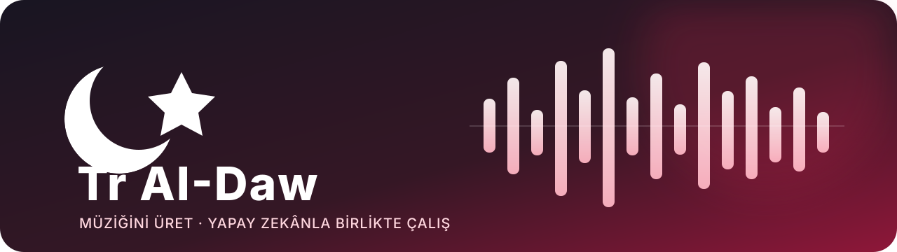

<p align="center">
  
</p>

<p align="center">
  <a href="https://github.com/TrKeyboarder/tr-ai-daw/actions/workflows/ci.yml"></a>
  <a href="./LICENSE"></a>
  <a href="https://github.com/TrKeyboarder/tr-ai-daw/pulls"></a>
  <a href="https://github.com/TrKeyboarder/tr-ai-daw/discussions"></a>
</p>

<p align="center">
  <a href="./README.md"><b>Türkçe</b></a> ·
  <a href="./README_EN.md"><b>English</b></a> ·
  <a href="https://github.com/heshengtao/ai-daw/blob/main/README_zh.md"><b>简体中文</b></a>
</p>

<h3 align="center">Müziğini üret. Düzenle. Yapay zekânla birlikte çalış.</h3>

**Tr AI-Daw**, açık kaynaklı AI DAW projesinin Türkçe topluluk sürümüdür. Gerçek bir dijital ses iş istasyonunu; yapay zekâ ajanlarının oturumu okuyup düzenleyebildiği bir üretim alanına dönüştürür. Projeler ve ses işleme yerel bilgisayarında kalır.

> Bu çalışma, [heshengtao/ai-daw](https://github.com/heshengtao/ai-daw) projesinden türetilmiş bağımsız bir topluluk sürümüdür; upstream projeyle resmî bağlantısı veya onayı yoktur. Türkçe çeviri topluluk katkılarıyla geliştirilmektedir.

<p align="center">
  
</p>

## Neler yapabilirsin?

| 🎼 Beste ve düzenleme | 🎚️ Kayıt ve miks | 🤖 Yerel yapay zekâ |
| --- | --- | --- |
| Çok kanallı MIDI/ses zaman çizelgesi, piyano rulosu, otomasyon, tempo ve ölçü değişiklikleri | Mikser, efektler, VST3/CLAP eklentileri, SoundFont ve WAV/MP3 dışa aktarma | MCP üzerinden ajan kontrolü; tempo analizi, sesten MIDI ve stem ayırma gibi yerel araçlar |

- **Müziğin kontrolü sende:** parçalar, klipler, notalar, otomasyon ve mikser tek bir projede.
- **Ajanın seninle aynı oturumda çalışsın:** MCP sunucusu ve `aidaw` CLI ile düzenlemeleri izle, geri al ve yönlendir.
- **Yerel öncelikli:** hesap veya API anahtarı gerekmez; isteğe bağlı büyük modeller ayrıca indirilir.
- **Türkçe arayüz:** Ayarlar bölümünden Türkçe’yi seçebilir veya sistem dili Türkçe olduğunda otomatik kullanabilirsin. Çeviri geliştikçe eksik metinler İngilizce/Çince yedek metinleriyle gösterilir.

## Başlarken

Henüz bu depoda yayımlanmış kurulum paketi yok. Kaynak koddan derleyebilir veya ilk kurulum paketleri için [Releases](https://github.com/TrKeyboarder/tr-ai-daw/releases) sayfasını takip edebilirsin.

### Linux için derleme

Rust (stable), Node.js 22+, pnpm 10 ve [Tauri Linux önkoşulları](https://v2.tauri.app/start/prerequisites/) gerekir.

```bash
git clone https://github.com/TrKeyboarder/tr-ai-daw.git
cd tr-ai-daw
pnpm install --frozen-lockfile

# Genel Linux x86_64 için optimize Debian paketi
CARGO_BUILD_JOBS=1 \
CARGO_PROFILE_RELEASE_LTO=thin \
CARGO_PROFILE_RELEASE_CODEGEN_UNITS=1 \
AIDAW_TARGET=x86_64-unknown-linux-gnu \
pnpm tauri build --target x86_64-unknown-linux-gnu --bundles deb
```

Derleme, makineye özel işlemci bayrakları kullanmaz; böylece sonuç daha geniş bir x86_64 sistem aralığında çalışabilir. Tauri, sistem bağımlılıkları ve diğer platformlar için upstream’in [derleme belgelerine](https://github.com/heshengtao/ai-daw#build-from-source) bak.

## Katkıda bulun

Türkçe çeviri, hata düzeltmeleri, testler, Linux deneyimi ve kullanım belgeleri için katkını bekliyoruz! Başlamak için:

1. Bir sorun veya öneri için [Issues](https://github.com/TrKeyboarder/tr-ai-daw/issues) aç; fikir alışverişi için [Discussions](https://github.com/TrKeyboarder/tr-ai-daw/discussions) bölümüne katıl.
2. Depoyu fork et, değişikliğini ayrı bir dalda geliştir ve `main` dalına bir pull request gönder.
3. Pull request’ler bir onaylı incelemeden sonra birleştirilir. PR açarken değişikliği ve çalıştırdığın kontrolleri belirt.

Detaylar için [CONTRIBUTING.md](./CONTRIBUTING.md) ve PR şablonuna göz at. Küçük bir çeviri düzeltmesi bile projeye değer katar.

## Proje bağlantıları

- **Kaynak kod:** [TrKeyboarder/tr-ai-daw](https://github.com/TrKeyboarder/tr-ai-daw)
- **Yol haritası ve topluluk:** [Tr AI-Daw GitHub Project](https://github.com/users/TrKeyboarder/projects/2)
- **Upstream proje:** [heshengtao/ai-daw](https://github.com/heshengtao/ai-daw)
- **Lisans:** [Apache License 2.0](./LICENSE). Model ağırlıkları ve bazı isteğe bağlı modeller ayrı lisanslara sahiptir; ayrıntılar için [MODELS.md](./MODELS.md) dosyasına bak.

---

<p align="center"><b>Birlikte daha erişilebilir ve Türkçe bir müzik üretim aracı geliştirelim. 🎶</b></p>
